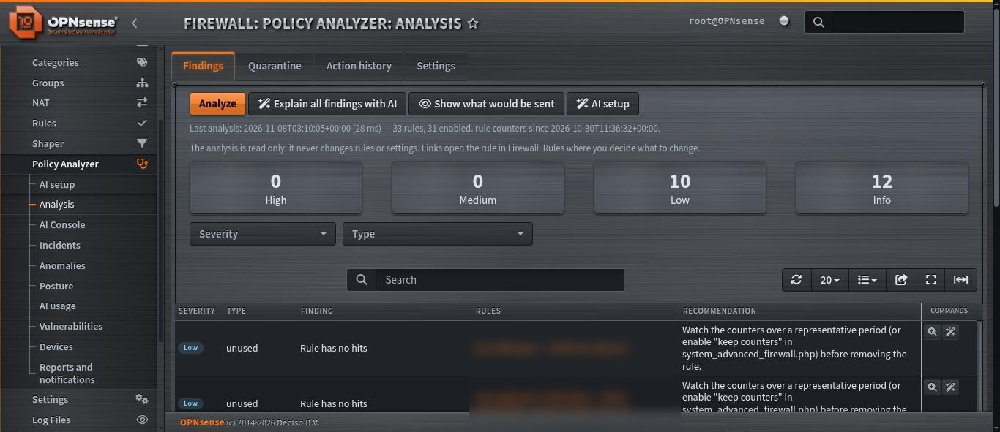
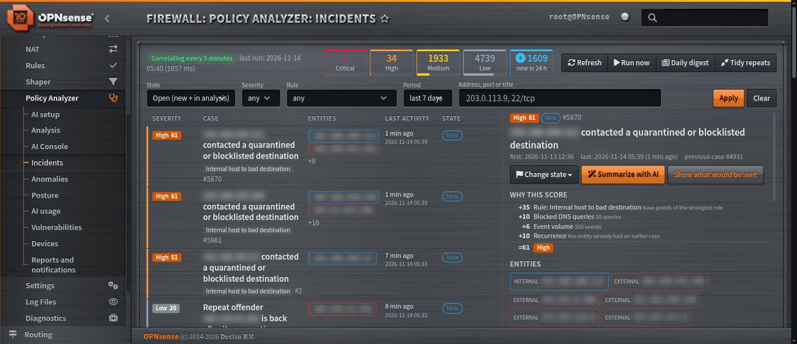
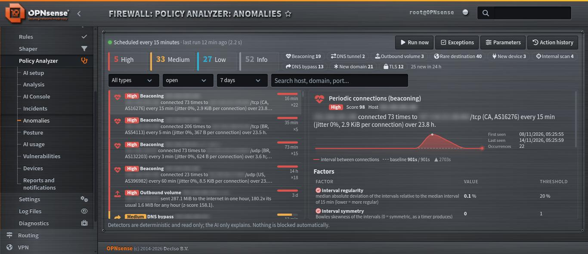
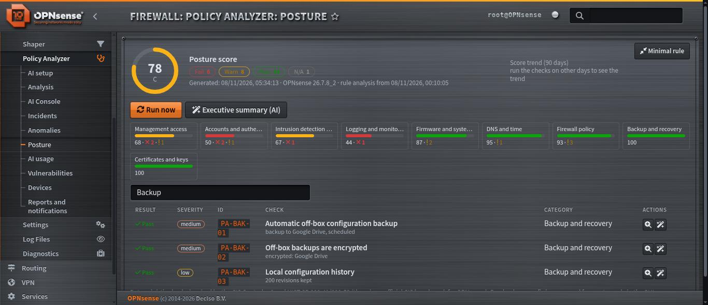
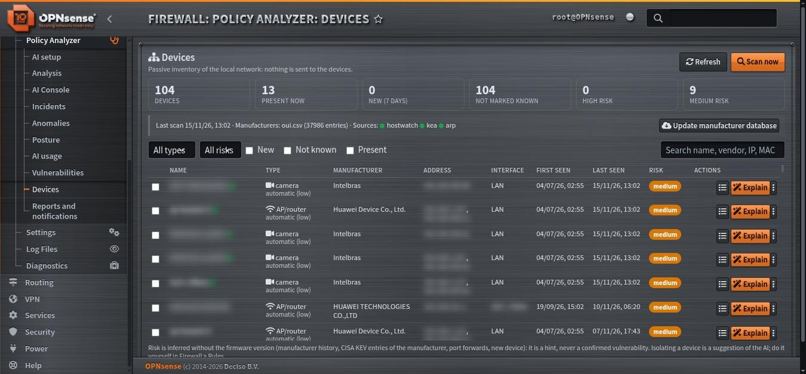
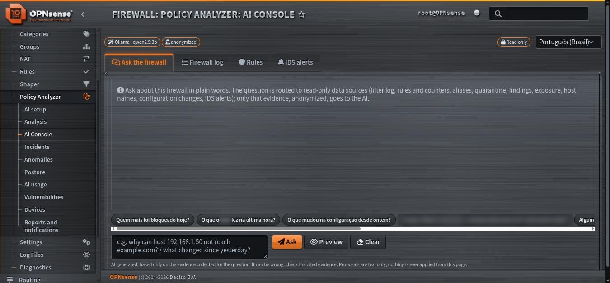
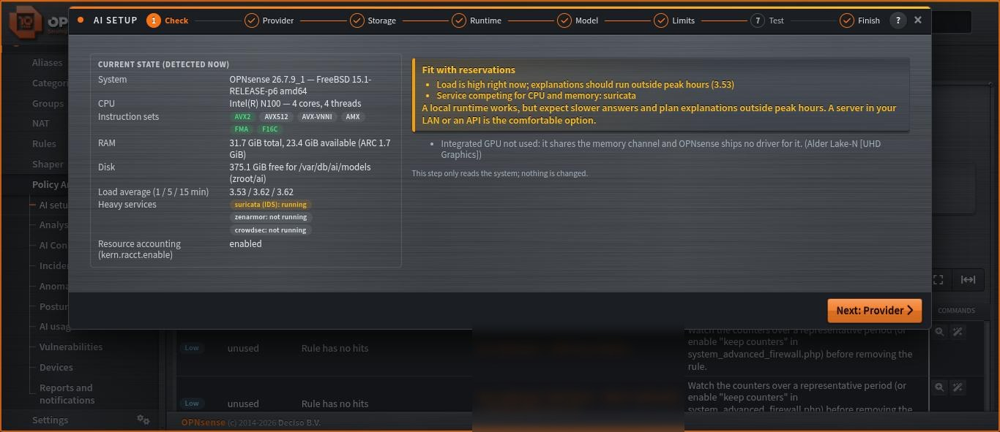
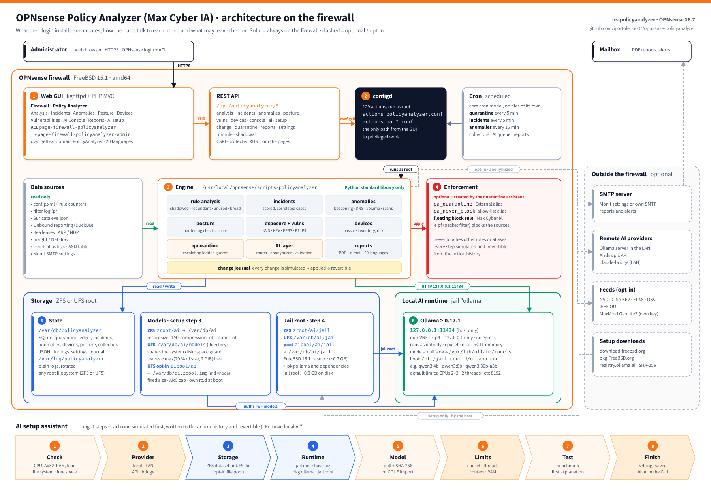

# OPNsense Policy Analyzer (Max Cyber IA)

Read-only analysis of the OPNsense firewall policy, with optional AI explanations, incident and anomaly detection,
exposure and vulnerability checks, device inventory, scheduled reports and an optional automatic quarantine.

Everything runs on the firewall. AI is optional and can stay local (Ollama); nothing leaves the firewall unless you
configure a remote AI provider or enable one of the external feeds.

> Status: development version (`os-policyanalyzer-devel`), tested on OPNsense 26.7 (amd64) and prepared for 27.1.
> It is not part of the official plugin repository: the OPNsense team prefers small, ports-based plugins, and this one
> ships a large Python engine and an optional jail for local AI. Following their advice
> ([opnsense/plugins#5926](https://github.com/opnsense/plugins/issues/5926)), it is maintained here as a standalone
> repository.

## What it does

| Page (Firewall › Policy Analyzer) | What you get |
|---|---|
| Analysis | findings on the rule set: shadowed, redundant, unused or too broad rules, risky exposures, with the evidence and a suggested fix; the quarantine setup assistant |
| AI Console | ask questions about your firewall in plain language; answers are built from the analysis, the logs and the configuration |
| Incidents | blocked and suspicious traffic grouped into incidents, with score and timeline |
| Anomalies | behaviour that changed: periodic beacons, new destinations, DNS oddities, traffic spikes |
| Posture | hardening checks of the firewall itself |
| Vulnerabilities | exposed services matched against CVE data (NVD, CISA KEV, EPSS, OSV), opt-in |
| Devices | local devices seen through DHCP, ARP/NDP and flows, classified by vendor and behaviour |
| AI usage | which AI provider answered what, time and tokens |
| Reports and notifications | daily/weekly PDF reports and alerts by e-mail |
| AI setup | step-by-step assistant to choose and install the AI provider |

Every change the plugin can make (quarantine, AI runtime, limits) follows the same contract: **simulate → apply →
revert**, recorded in an action history.

## Screenshots

Taken on my own firewall (OPNsense 26.7.9, Forja theme); addresses, host and device names are blurred.

| | |
|---|---|
| **Analysis**<br> | **Incidents**<br> |
| **Anomalies**<br> | **Posture**<br> |
| **Devices**<br> | **AI Console**<br> |
| **AI setup**<br> | |

## Architecture



What the plugin installs and creates on the firewall: the MVC pages and REST API, the configd actions (the only path to
privileged work), the Python engine, the optional quarantine objects, the storage created by the AI setup assistant
and the local Ollama jail bound to 127.0.0.1 only. On a ZFS installation the storage is a dataset of the root pool
(`zroot/ai` for the models, `zroot/ai/jail` for the runtime); ZFS is not required, see
[UFS installations](#ufs-installations).
Vector versions: [PDF](docs/architecture.pdf) · [SVG](docs/architecture.svg).

AI providers, what is in development and possible improvements: [roadmap](docs/roadmap.png)
([PDF](docs/roadmap.pdf) · [SVG](docs/roadmap.svg)).

### Sample reports

Rendered by the plugin's own report generator from a synthetic critical scenario (documentation addresses, CVE-2099-*,
example.test names); the executive and alert summaries were written by an AI through the plugin's summary code path:

- [Daily security report](docs/samples/report-critical-scenario.pdf) (7 pages)
- [Alert e-mail attachment](docs/samples/alert-critical-scenario.pdf)

## Requirements

- OPNsense 26.7 or later, amd64.
- Root file system: **ZFS or UFS**, both supported (see [UFS installations](#ufs-installations) for what changes).
- No extra Python packages: it uses the Python 3 that ships with OPNsense (no pip, no ports outside the base system).
- For the local AI runtime only: about 2 GB of disk for the runtime plus the size of the models (2–20 GB), and the
  free-space guard keeps at least 2 GiB free on `/var` (plan for about 4 GiB free before the first model); enough
  RAM for the chosen model (the assistant checks the hardware and recommends one).

## UFS installations

ZFS is not required. Without it, the analysis, incidents, anomalies, posture, devices, reports and the remote AI
providers work exactly the same; only the local AI runtime stores things differently:

| | ZFS root (`zroot`) | UFS root |
|---|---|---|
| Analysis, incidents, anomalies, posture, devices, reports, remote AI | yes | yes |
| Local AI models | dataset `zroot/ai` on `/var/db/ai` | directory `/var/db/ai/models` on the system disk, or the optional pool in a file |
| Local AI jail | dataset `zroot/ai/jail` | directory `/var/db/ai/jail` (or `aipool/ai/jail`) |
| Remove the models | `+remove_dataset zroot/ai` | `+remove_dataset /var/db/ai/models` (or `aipool/ai`) |
| Disk metrics in the health collector | pool usage (`zpool list`) | root file system usage (`df`) |
| Free-space guard before large downloads | yes | yes |


- `/var/db/ai` (jail root and models) is a plain directory on the system disk, so the models (several GB each)
  share the space of `/var` with the logs, the configuration backups and the updates.
- Every action that writes large files (install the runtime, download or import a model) checks the free space
  first and refuses when less than 20 % above its estimate, and never less than 2 GiB, would stay free on the file
  system that holds `/var`.
- Removing the runtime together with the models asks for the path as confirmation instead of a dataset name:
  `configctl policyanalyzer change_apply uninstall_runtime +remove_dataset /var/db/ai/models`.

Two ways to keep the models from filling the system disk:

1. **An Ollama server in your LAN** (provider Ollama, "On a server in my LAN"): nothing is stored on the firewall.
2. **A ZFS pool in a file** (optional, only when you ask for it): a preallocated image `/var/db/ai.zpool.img` of
   the size you choose holds a small pool `aipool` mounted on `/var/db/ai`, so the models can never use more than
   that size. It stacks two file systems and loads ZFS (whose cache uses RAM; `arc_mb` caps it), so prefer option 1
   on small firewalls.

   ```sh
   configctl policyanalyzer change_plan create_file_pool 40 512     # simulate: 40 GiB image, ARC capped at 512 MiB
   configctl policyanalyzer change_apply create_file_pool 40 512    # runs in the background
   configctl policyanalyzer setup_job                               # progress
   ```

   An rc script (`/usr/local/etc/rc.d/policyanalyzer_aipool`) attaches the image and imports the pool at boot,
   before the jail starts. Revert the action from the history while the pool is still empty, or delete it with its
   content: `configctl policyanalyzer change_apply remove_file_pool aipool` (remove the runtime first).

Design notes and the ZFS/UFS test report (two KVM labs, four rounds): [docs/file-systems.md](docs/file-systems.md).
Full UFS guide (fixes, risks, the pool in a file, the LAN alternative, commands): [docs/ufs-alternative.md](docs/ufs-alternative.md).

## Installation

The plugin uses the build system of the official `opnsense/plugins` tree.

**As a package (recommended)**, on a FreeBSD/OPNsense build host:

```sh
git clone https://github.com/opnsense/plugins.git
git clone https://github.com/igortoledo007/opnsense-policyanalyzer.git
cp -R opnsense-policyanalyzer/plugin plugins/security/policyanalyzer
cd plugins/security/policyanalyzer
make package        # -> work/pkg/os-policyanalyzer-devel-<version>.pkg
```

Copy the package to the firewall and install it:

```sh
pkg add ./os-policyanalyzer-devel-<version>.pkg
```

**Manual copy (lab firewalls only):**

```sh
scp -r plugin/src/opnsense/* root@<firewall>:/usr/local/opnsense/
ssh root@<firewall> 'grep -rlE --include=*.py "^#!" /usr/local/opnsense/scripts/policyanalyzer | xargs chmod 755 && service configd restart'
ssh root@<firewall> 'rm -f /var/lib/php/tmp/opnsense_menu_cache.xml /var/lib/php/tmp/opnsense_acl_cache.json'
ssh root@<firewall> 'configctl webgui restart'
```

Log in again and open **Firewall › Policy Analyzer › Analysis**. The first analysis runs from that page.

### Permissions

Two privileges are added under System › Access › Groups:

- `page-firewall-policyanalyzer`: read the pages and run analyses;
- `page-firewall-policyanalyzer-admin`: settings, AI setup, quarantine and every change.

## Setup

Each part below is optional. Without any of them the Analysis, Posture and Devices pages already work.

### 1. Logging

Incidents, Anomalies and the quarantine read the firewall log. Enable **Log packets** on the rules you want to
watch (Firewall › Rules); the default block rules already log.

### 2. Country data (GeoIP, free)

Used for countries in incidents, anomalies and the quarantine. It uses the GeoIP lists that OPNsense downloads with
**your own** MaxMind account, as in the [official how-to](https://docs.opnsense.org/manual/how-tos/maxmind_geo_ip.html):

1. Create a free account: https://www.maxmind.com/en/geolite2/signup
2. In the account, open **My License Key**, generate a key and answer "no" to geoipupdate.
3. In **Firewall › Aliases › GeoIP settings**, set the URL below (with your key) and click **Apply**:
   `https://download.maxmind.com/app/geoip_download?edition_id=GeoLite2-Country-CSV&license_key=<LICENSE_KEY>&suffix=zip`
4. Create at least one GeoIP alias, so the lists are downloaded.

The plugin never ships or uploads GeoIP data.

### 3. AI provider (optional)

Open **Firewall › Policy Analyzer › AI setup**. The assistant checks the hardware, then offers:

| Provider | What you need | Where the data goes |
|---|---|---|
| Ollama on the firewall | the assistant installs it in a FreeBSD jail (`/var/db/ai`), downloads the runtime (about 335 MB from freebsd.org) and a model you choose; Ollama 0.17.1 or later | stays on the firewall; the jail has no Internet access |
| Ollama on another computer | an Ollama server in your LAN, e.g. `http://192.0.2.10:11434` | your LAN |
| Anthropic API | an API key from console.anthropic.com (paid per use) | api.anthropic.com |
| Claude Code (LAN) | the `bridge/` service of this repository on a computer in your LAN with Claude Code installed and logged in | that computer, then Anthropic |

Recommended local models (the assistant picks one by RAM): `qwen3:4b`, `qwen3:8b`, `qwen3:30b-a3b`. Limits (CPUs,
threads, context, RAM) are set in the Limits step. **Anonymize** (Settings) replaces addresses, host names and
other identifying values before anything is sent to a remote provider.

To remove the local AI: AI setup › Runtime › **Remove local AI** (optionally also the downloaded models).

### 4. Quarantine (optional)

From the Analysis page, the quarantine assistant can block sources that keep attacking. When you apply it, it
creates:

- the aliases `pa_quarantine` (addresses in quarantine) and `pa_never_block` (addresses never blocked);
- one floating block rule with the description `Max Cyber IA`;
- cron jobs: quarantine every 5 minutes, incidents every 5 minutes, anomalies every 15 minutes.

Every step is simulated first and can be reverted from the action history.

### 5. Reports by e-mail (optional)

Reports and notifications: daily or weekly PDF and alerts. It can reuse the SMTP server configured in Monit
(Services › Monit), or use its own SMTP settings (the password is stored in a file readable by root only).

### 6. Optional data sources and feeds

Used when present, never required: Suricata (`eve.json`), Unbound reporting, Insight/NetFlow, Kea DHCP.
External feeds are opt-in and only downloaded when enabled: NVD, CISA KEV, FIRST EPSS, OSV, GitHub advisories,
IEEE OUI, rulesets.opnsense.org and huggingface.co (model metadata).

## Languages

The GUI and the PDF/e-mail reports are available in the 20 languages of OPNsense: English, Čeština, Deutsch,
Ελληνικά, Español, فارسی, Français, Italiano, 日本語, 한국어, Norsk, Polski, Português (Brasil), Português (Portugal),
Русский, Türkçe, Українська, Tiếng Việt, 简体中文 and 繁體中文. The plugin follows the language set in OPNsense
(System › Settings › General, or the user's own setting).

- The GUI uses its own gettext domain (`PolicyAnalyzer`), so the core catalogue is never touched; strings the core
  already translates keep the core translation.
- PDF reports are rendered in the selected language for Latin, Greek and Cyrillic scripts (the font of the default
  theme is embedded). Chinese, Japanese, Korean and Persian reports fall back to English in the PDF, because
  OPNsense ships no font for those scripts; the e-mail text stays in the selected language.
  `POLICYANALYZER_PDF_FONTS=regular.ttf:bold.ttf` points the PDF to another TrueType font.
- The translations were made with AI assistance and checked mechanically (placeholders, HTML, gettext format) and by
  a review pass. **Native speakers are very welcome to correct them**: edit `i18n/<lang>.po` (GUI) or
  `plugin/src/opnsense/scripts/policyanalyzer/i18n/<lang>.json` (reports) and run
  `python3 tools/pa-i18n.py check` and `python3 tools/pa-i18n.py compile` before opening a pull request.

## Uninstall

1. Remove the local AI first (AI setup › Runtime › Remove local AI), if installed.
2. Revert the quarantine from the action history, if applied (removes the rule, aliases and cron jobs).
3. `pkg delete os-policyanalyzer-devel`
4. Optional: remove the data in `/var/db/policyanalyzer`, `/var/log/policyanalyzer` and `/var/db/ai` (with the pool
   in a file: `remove_file_pool aipool` before removing the package).

## Claude Code bridge (`bridge/`)

A small HTTP service for a Linux computer in the LAN that has Claude Code installed. The plugin sends the prompt,
the bridge runs `claude -p` with every tool disabled (no file access, no commands, no MCP) and returns only the text.
Access is limited to the firewall addresses and a bearer token. See `bridge/README.md`.

## Tests

From the repository root (no firewall needed; all data is synthetic and uses documentation addresses):

```sh
for d in "" ai anomalies collect console devices exposure incidents minrule posture quarantine reports setup shadowai vulns; do
  PYTHONDONTWRITEBYTECODE=1 python3 -m unittest discover -s "tests/$d" -t "tests/$d"
done
```

## AI disclosure

Developed with AI assistance: Claude (Anthropic), a mix of the Fable 5.2 and Opus 5.5 models. I reviewed and tested
it on my own OPNsense firewall.

## License

BSD 2-Clause, see [LICENSE](LICENSE). OPNsense® is a registered trademark of Deciso B.V.

Our community is crucial in shaping the ongoing development of our open-source OPNsense® software products.
