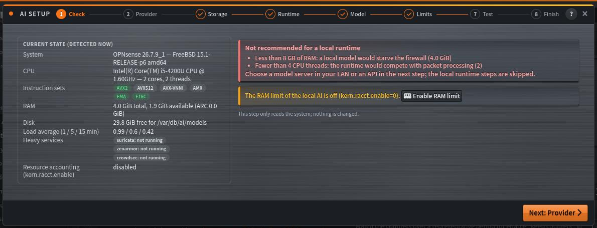
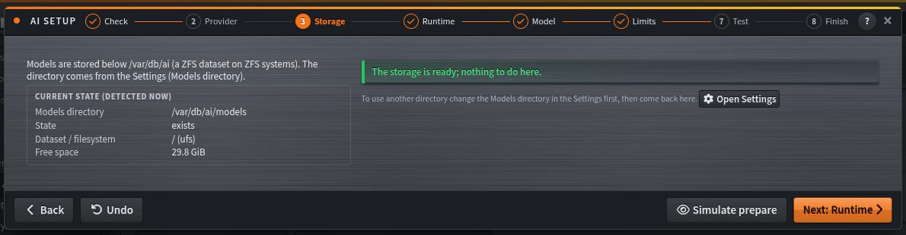
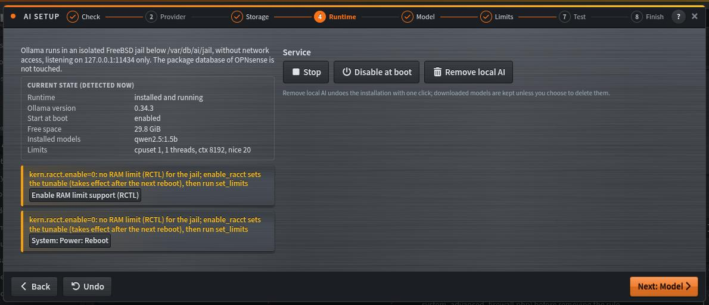

# ZFS and UFS: design notes and test report

The Policy Analyzer supports both OPNsense root file systems, ZFS and UFS. Both are supported and tested, and changes to
the local AI runtime are tested on both. This page explains what differs and how it was tested.

## Why this page exists

In [opnsense/plugins#5926](https://github.com/opnsense/plugins/issues/5926) the OPNsense team pointed out that the
plugin relies on custom ZFS datasets and suggested a warning for UFS installations. Instead of a warning only, the
UFS path was completed and tested; the remaining differences are documented here and in the README
([UFS installations](../README.md#ufs-installations)); the full UFS guide is [ufs-alternative.md](ufs-alternative.md).

## What depends on the file system

Only the optional local AI runtime (Ollama in a jail) and its models. Everything else (analysis, incidents,
anomalies, posture, devices, reports, remote AI providers) writes small files to `/var/db/policyanalyzer` and works
the same on any file system.

| | ZFS root (`zroot`) | UFS root | UFS + pool in a file (opt-in) |
|---|---|---|---|
| Models | dataset `zroot/ai` on `/var/db/ai` (recordsize=1M, compression=off, atime=off, primarycache=metadata) | directory `/var/db/ai/models` on the system disk | dataset `aipool/ai` on `/var/db/ai`, inside the preallocated image `/var/db/ai.zpool.img` |
| Jail root | dataset `zroot/ai/jail` (lz4) | directory `/var/db/ai/jail` | dataset `aipool/ai/jail` |
| Size limit for the models | free space of the pool | free space of `/var` | the image size (fixed) |
| Remove the models | `uninstall_runtime +remove_dataset zroot/ai` | `uninstall_runtime +remove_dataset /var/db/ai/models` | `uninstall_runtime +remove_dataset aipool/ai`, then `remove_file_pool aipool` |
| Health collector, disk | `zpool list` | `df -kP /` | both (the pool and the UFS root) |
| Free-space guard | yes: what stays free after the download must be at least max(20 % of the estimate, 2 GiB) on the file system of `/var` | yes | yes |

The pool in a file is created only on request (`create_file_pool <GiB> [arc_mb]`). An rc script
(`/usr/local/etc/rc.d/policyanalyzer_aipool`, `BEFORE: jail`) attaches the image with `mdconfig` and imports the pool
at boot, with `cachefile=none`, so no system-wide ZFS configuration is touched. It stacks two file systems and
loads ZFS (ARC in RAM, capped by `arc_mb`); on small firewalls an Ollama server in the LAN is the better choice.

## How it was tested

Two throw-away KVM virtual machines built from the official 26.7 images and updated to OPNsense 26.7.9_1
(FreeBSD 15.1-RELEASE-p6), 2 vCPU and 4 GiB each:

- **UFS**: `OPNsense-26.7-nano-amd64.img` (UFS root, `/var/log` on tmpfs);
- **ZFS**: `OPNsense-26.7-serial-amd64.img` installer, "Install (ZFS)", stripe on one disk.

The plugin was installed from the working tree with the same installer used on real firewalls. Four rounds were run;
each bug found was fixed and got a unit test (1011 unit tests in total). The fixes of rounds 1–3 were re-tested in
both labs; the last fixes (rounds 4 and later) were re-tested in the UFS lab only.

| Scenario | UFS | UFS + pool in a file | ZFS |
|---|---|---|---|
| GUI: 10 pages and 12 API endpoints, no PHP errors | ok | ok | ok |
| Storage step | directory | `aipool/ai` | `zroot/ai` with the tuned properties |
| Runtime install with default limits on a 2-cpu host | ok | ok (`aipool/ai/jail`) | ok (`zroot/ai/jail`) |
| Model download (qwen2.5:1.5b, SHA-256 checked) and test question | ok | ok | ok |
| Reboot: jail starts by itself, Ollama answers | ok | ok, pool imported before the jail | ok |
| Clean shutdown | ok | ok, pool exported | ok |
| Health collector | `df` metrics | pool and `df` metrics | pool metrics |
| Free-space guard (70B model that does not fit) | blocked | blocked | blocked |
| `create_file_pool` | allowed | n/a | blocked (already ZFS) |
| Uninstall with the models, right after stopping the jail | ok | ok | ok |
| Remove the pool in a file | n/a | ok: image, md device, rc files and ARC cap gone | n/a |

Bugs found by the lab and fixed in this change:

1. Removing the models failed on UFS ("/var/db/ai is not a ZFS dataset").
2. Default cpu set `2-3` did not exist on 2-cpu hosts, so the runtime could not be installed without arguments.
3. Five scripts lacked the executable bit in git; the AI test question failed with exit 126.
4. The jail did not start at boot when `/var/log` is a tmpfs (nano images, RAM disk option): its console log
   lived there. It now lives in `/var/db/ai`.
5. `zfs destroy` of the jail dataset failed with "dataset is busy" right after `jail -r` (also on ZFS roots), and the
   rollback left Ollama stopped. The step now waits up to 90 s and the rollback restarts the jail.
6. The pool export at shutdown hit the same busy window; the rc script now retries for up to 75 s.
7. The jail console log left in `/var/db/ai` blocked `create_file_pool`; it is now ignored and removed with the models.
8. `rc.freebsd` reads a service pid from the last field of `status` and kills it after 30 s; the pool status ended
   with the free space ("17.8G" became pid 178). The status no longer ends with digits.
9. With the pool in a file, the health collector stopped measuring the UFS root disk.
10. `install_runtime` failed when the models directory did not exist (storage step skipped, or after
    `remove_file_pool`); it now creates the directory before giving it to the jail user.

## Screenshots (UFS lab)

OPNsense 26.7.9_1 nano image, UFS root, with the Forja theme. The AI setup assistant detects the UFS root, keeps the
models in a plain directory on the system disk and runs the Ollama jail from `/var/db/ai/jail`.

Step 1, Check: hardware, free space for `/var/db/ai/models` and the recommendation for this small VM.

Step 3, Storage: `/var/db/ai/models` on `/ (ufs)`, no dataset needed.

Step 4, Runtime: Ollama 0.34.3 installed and running in the jail on UFS, model `qwen2.5:1.5b`, default limits adapted
to a 2-cpu host.

Not covered by the lab: the rollback that restarts Ollama after a failed uninstall (a unit test only checks that the stop step keeps its inverse), RCTL memory limits (racct is off on stock OPNsense), Vulkan GPUs, and a power loss while the
pool in a file is imported (it imports again with the same hostid; the models can be downloaded again).
